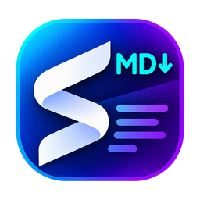

<p align="center">
  
</p>

<h1 align="center">SolidMD</h1>

<p align="center">
  <strong>A fast, stable Markdown editor with a live preview, for Windows, macOS and Linux.</strong>
</p>

<p align="center">
  <a href="https://github.com/isumer/solidmd/actions/workflows/ci.yml"></a>
  <a href="https://github.com/isumer/solidmd/releases/latest"></a>
  
  <a href="LICENSE.md"></a>
</p>

---

SolidMD is a desktop editor for Markdown and plain-text files. You write on the
left and see the rendered page on the right as you type. The goal is a
Notepad++-class everyday editor in which Markdown is a first-class citizen:
it opens instantly, handles very large files and never loses your work.

> **Status: early development (pre-release).** The editor, the preview, tabs,
> saving and crash recovery work today. Several planned features — export
> menus, themes, file comparison and more — are still being built. See
> [What's next](#whats-next).

_Screenshots coming soon._

## Why SolidMD

- **It does not lose your text.** Saves are atomic, drafts are written in the
  background, and after a crash SolidMD offers to restore what you had.
- **It stays fast on big files.** The editor only draws the lines on screen, and
  the preview renders off the main thread, so a 20 MB document opens quickly
  and typing stays smooth.
- **It is safe to open untrusted documents.** Markdown cannot run scripts, the
  preview is sandboxed, and the app can only write to files you chose.
- **It looks and behaves the same everywhere.** One rendering engine on
  Windows, macOS and Linux, so the preview — and later the PDF — matches on
  every platform.

## Features

### Writing and preview
- Side-by-side editor and live preview.
- GitHub-flavoured Markdown: tables, task lists, strikethrough and automatic links.
- Code blocks highlighted for [36 languages](docs/languages.md).
- Relative images load from the document's own folder, and nowhere else.
- Links in the preview never navigate the app window, and unsupported link types are blocked.

### Files and tabs
- Several files open at once, each tab with its own undo history, cursor,
  scroll position and preview.
- Open files from the menu, by drag and drop, or from the command line.
- Open, Save and Save As, with a clear prompt when you close or quit with
  unsaved changes.
- Your session — open tabs, including unsaved changes — comes back the next
  time you start the app.
- On Windows, the installer adds "Edit with SolidMD" to Explorer's right-click menu.
- Binary files are detected and not opened as text; byte-order marks are kept
  as they were.

### Workspace sidebar
- **Open Folder** shows the folder as a tree on the left.
- Folders load as you expand them, so large projects open quickly.
- A filter box finds files by name.

### Large documents
- Files over 4 MiB open without highlighting so editing stays responsive.
- The preview updates incrementally, rendering only what changed.
- Edits are batched, and only the changes travel to the save path.

### Reliability
- **Atomic saves:** the file is written to a temporary copy and swapped in, so a
  failed write never leaves a half-written file. File permissions are kept,
  symbolic links are followed, overlapping saves are queued, and on Windows a briefly locked file is retried.
- **Drafts and crash recovery:** unsaved work is saved as a draft at regular
  intervals and offered back after a crash.
- **Self-healing parts:** file reading and writing run in a separate process
  that restarts on its own if it crashes; a stuck preview also restarts
  itself.
- Errors are explained in plain language, without stack traces.

### Keyboard
- One central list of shortcuts, used by the menus and the editor alike.
- Shortcuts work on non-Latin keyboard layouts, and AltGr characters type
  normally instead of triggering commands.
- File, Edit, Window and Help menus.

## Security

SolidMD treats every document as untrusted:

- The window runs with sandboxing and context isolation, under a strict
  Content Security Policy, and the app is served from its own private scheme.
- Markdown and raw HTML are sanitised before display, so a document cannot
  run scripts.
- The page talks to the rest of the app through a small, fixed API. Every
  message is checked for shape and size (up to 256 MiB).
- The file process only touches files that were opened or chosen by you.

To report a vulnerability, please follow [SECURITY.md](SECURITY.md) rather
than opening a public issue.

## Download

Builds for every platform are produced by CI and published on the
[Releases](https://github.com/isumer/solidmd/releases) page.

| Platform | Packages |
|---|---|
| Windows | Installer, portable zip |
| macOS | DMG (Apple silicon and Intel) |
| Linux | `.deb`, AppImage |

No release has been published yet; until the first one, build from source
as described below.

## Build from source

You need [Node.js](https://nodejs.org/) 24 (see `.nvmrc`) and npm.

```sh
git clone https://github.com/isumer/solidmd.git
cd solidmd
npm ci          # install the exact, locked dependencies
npm start       # build and launch the app
npm run verify  # type checks, unit and end-to-end tests, and the project checks
```

Platform packages are built with `npm run dist:linux`, `npm run dist:win` or
`npm run dist:mac`.

## What's next

Planned for the first release (details in [PLAN.md](PLAN.md)):

- Export the preview as a self-contained HTML file or a PDF (the engine exists;
  the menu is coming).
- Scroll sync between editor and preview, and editor-only or preview-only views.
- Light, dark and follow-system themes, and a custom background colour.
- Plain text and source files with language-aware highlighting.
- Everyday Notepad++-style tools.
- Compare files and folders, and a three-way merge view.

Not planned for v1: live collaboration, plugins, Vim mode and cloud sync.

## Documentation

| Document | What it covers |
|---|---|
| [PLAN.md](PLAN.md) | Requirements, stack, stability budget and the build plan |
| [docs/architecture.md](docs/architecture.md) | How the app is put together |
| [docs/release.md](docs/release.md) | How releases are built and published |
| [docs/languages.md](docs/languages.md) | Languages highlighted in code blocks |
| [CHANGELOG.md](CHANGELOG.md) | What changed in each version |
| [SECURITY.md](SECURITY.md) | Reporting a vulnerability |

## Contributing and bug reports

Bug reports and feature requests are welcome — please use the
[issue templates](https://github.com/isumer/solidmd/issues/new/choose).
Before opening a pull request, make sure `npm run verify` passes.

## License

SolidMD is free software under the [GPL-3.0-or-later](LICENSE.md) licence:
you may use, study, modify and share it; derivative works must use the same
licence.
